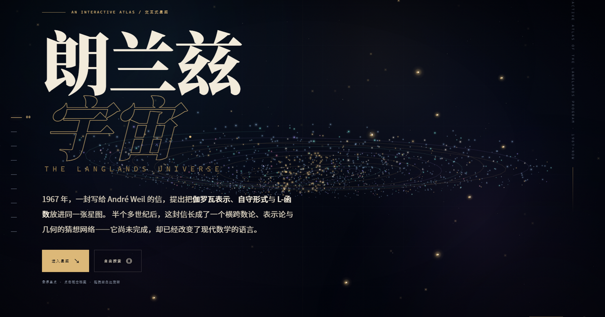

# 朗兰兹宇宙 · The Langlands Universe

一个**可交互的 3D 数学宇宙**，用中文详细介绍朗兰兹纲领（Langlands Program）的历史、核心内容、人物、研究现状与争议。

- 9 个章节：导览、核心、历史、人物、概念、现状、边界、档案、自由探索。
- 22 份人物档案、27 个历史节点、15 个概念档案、4 层研究现状矩阵。
- 7 幅原创 SVG 图版、22 枚生成式人物星徽、实时 Canvas 透视星图。
- 无框架、无 CDN、无追踪；可直接打开 `index.html`，也可用任意静态服务器运行。
- 自由探索模式支持拖拽旋转、滚轮缩放、双击复位、场景切换与 3D 节点点击。



## 打开方式

### 方式一：直接打开（最简单）

双击 `index.html`。页面使用经典 `<script>` 加载，不依赖构建工具或网络，因此 `file://` 下也能运行。

### 方式二：本地静态服务器

在本目录运行：

```bash
python -m http.server 8787
```

然后访问 <http://127.0.0.1:8787/>。

Windows 下也可以双击 `start-site.cmd`（需要已安装 Python）。

## 交互指南

| 操作 | 效果 |
| --- | --- |
| 拖拽空白处 / 星空 | 旋转视角 |
| 滚轮（自由探索模式） | 缩放 |
| 双击空白处 | 复位视角 |
| 悬停主视觉中的星点 | 显示概念标签 |
| 点击星点 / 卡片 / 时间线 | 打开档案或展开条目 |
| `G` | 打开星图目录 |
| `Esc` | 关闭弹层、目录或自由探索 |
| 方向键（自由探索） | 旋转视角 |
| `+` / `-`（自由探索） | 缩放 |
| `R`（自由探索） | 复位当前场景 |

### 可分享的深链接

- `?explore=1`：直接进入自由探索。
- `?explore=1&scene=duality`：进入自由探索并切换至对偶场景。
- `?section=history`：直接定位到某一章节。
- `?person=langlands`：直接打开朗兰兹的人物档案。
- `?concept=functoriality`：直接打开函子性概念档案。

场景名：`galaxy`、`rosetta`、`duality`、`history`、`people`、`concepts`、`frontier`、`critique`、`library`。

## 章节地图

1. **00 起点 / ORIGIN** — 朗兰兹宇宙的入口与整体命题。
2. **01 导览 / ORIENTATION** — 算术、表示、几何三种语言；罗塞塔石碑图版。
3. **02 核心 / CORE** — 互反、函子性、L-群、L-函数、局部—整体、迹公式；5 幅图版。
4. **03 历史 / HISTORY** — 1900—2025 的 27 个节点，可按年代筛选。
5. **04 人物 / PEOPLE** — 22 位数学家的星徽与详细档案，可按角色筛选。
6. **05 概念 / CONCEPTS** — 15 个概念的索引、卡片与关系图。
7. **06 现状 / STATUS** — 局部 / 函数域 / 数域 / 几何四层矩阵，以及“已建立 / 部分 / 开放 / 几何突破”标记。
8. **07 边界 / CRITIQUE** — 对“大统一”叙事的建设性批评、常见误解与新闻判断清单。
9. **08 档案 / LIBRARY** — 推荐书目、参考入口、术语表与技术/版权说明。

## 文件结构

```text
langlands-universe/
├─ index.html                # 页面结构与正文
├─ favicon.svg
├─ start-site.cmd            # 可选的本地服务器启动脚本
├─ README.md
├─ css/
│  └─ style.css              # 视觉系统、版式、响应式与动效
├─ js/
│  ├─ data.js                # 人物、时间线、概念、现状、术语、来源
│  └─ app.js                 # 内容渲染、交互、Canvas 透视引擎
├─ assets/
│  ├─ fig-rosetta.svg        # 图版 01 · 三种语言
│  ├─ fig-duality.svg        # 图版 02 · 对偶
│  ├─ fig-functoriality.svg  # 图版 03 · 函子性
│  ├─ fig-lfunction.svg      # 图版 04 · L-函数
│  ├─ fig-map.svg            # 图版 05 · 概念地图
│  ├─ fig-trace.svg          # 图版 06 · 迹公式
│  ├─ fig-web.svg            # 图版 07 · 概念之网
│  ├─ og-cover.png           # 社交分享封面
│  └─ portraits/             # 22 枚人物星徽 SVG
└─ tools/
   └─ make_art.py            # 重新生成全部 SVG 图版与星徽
```

## 关于 3D

这里的“3D”不是预先渲染的视频，而是一个**无依赖的 Canvas 2D 透视引擎**：

- 相机有 yaw / pitch / distance，所有粒子、连线与节点都经过透视投影。
- 9 个场景分别对应星系、三语言、对偶、时间螺旋、人物星座、概念结、前沿层、边界与档案。
- 滚动章节会切换场景；自由探索模式提供完整的轨道控制与场景切换。
- 节点位置会随相机实时投影，HTML 标签与 3D 坐标同步；点击标签打开对应档案。
- 尊重 `prefers-reduced-motion`：降低动效时不会自动旋转。

这比 WebGL 方案轻，能在没有 GPU / 没有网络的机器上运行；代价是粒子数量与光照效果有所限制。

## 图像与版权

- 站内 **7 幅图版**、**22 枚人物星徽**、favicon、Canvas 星图均为本项目原创或程序生成。
- **没有使用人物照片**。人物卡片上的图案是由姓名、年份与领域编码生成的“数学星徽”，不是写实肖像，也不试图模拟外貌。
- 字体使用系统字体（Noto Serif SC / Songti SC / SimSun 等回退），不加载外部字体 CDN。
- 页面不包含第三方追踪、分析脚本或 cookie。

## 学术说明

- 本站是**科普 / 导览**，不是专业论文，也不隶属于任何机构。
- 数学表述经过简化；年份指向关键论文或公开事件，不表示所有工作都在当年完成。
- 研究状态截至 **2025 年**。朗兰兹纲领是一组相互关联的猜想，不同群、不同域、局部/整体、算术/几何版本的状态差异很大；“已证明”总是相对于某个精确表述而言。
- 2024 年几何朗兰兹系列论文是特定设定（特征 0，de Rham/Betti 等）下的重大突破，**不是**算术数域上一般朗兰兹的证明；数学界仍在审阅与吸收。
- 若用于教学、引用或进一步研究，请回到 `js/data.js` 中列出的原始文献与机构档案核对。

## 重新生成图版

需要 Python 3 与 Pillow（`make_art.py` 实际只使用标准库；Pillow 仅用于可选的预览处理）：

```bash
python tools/make_art.py
```

脚本会以确定性随机种子重写 `assets/fig-*.svg`、`assets/portraits/*.svg` 与 `favicon.svg`。修改文字或版式后重新运行即可。

## 技术

- 原生 HTML / CSS / JavaScript，无构建步骤。
- Canvas 2D 透视引擎，DPR 上限 2，移动端自动降低粒子数。
- IntersectionObserver 驱动章节场景切换、滚动显现与人物卡片入场。
- 无障碍：跳转链接、键盘可操作卡片、弹层焦点管理、`aria-hidden` 同步、`prefers-reduced-motion`。
- 页面不依赖网络；所有资源使用相对路径。

---

**朗兰兹宇宙** · 为好奇的读者而作，也为仍然在黑暗中航行的数学家而作。
